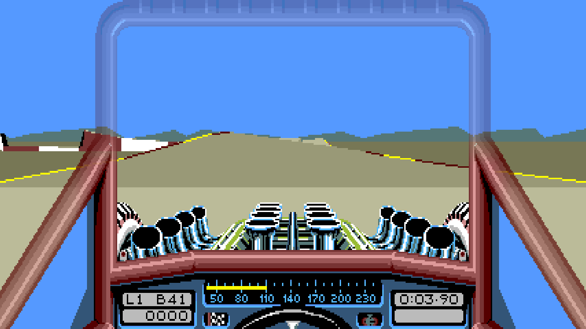
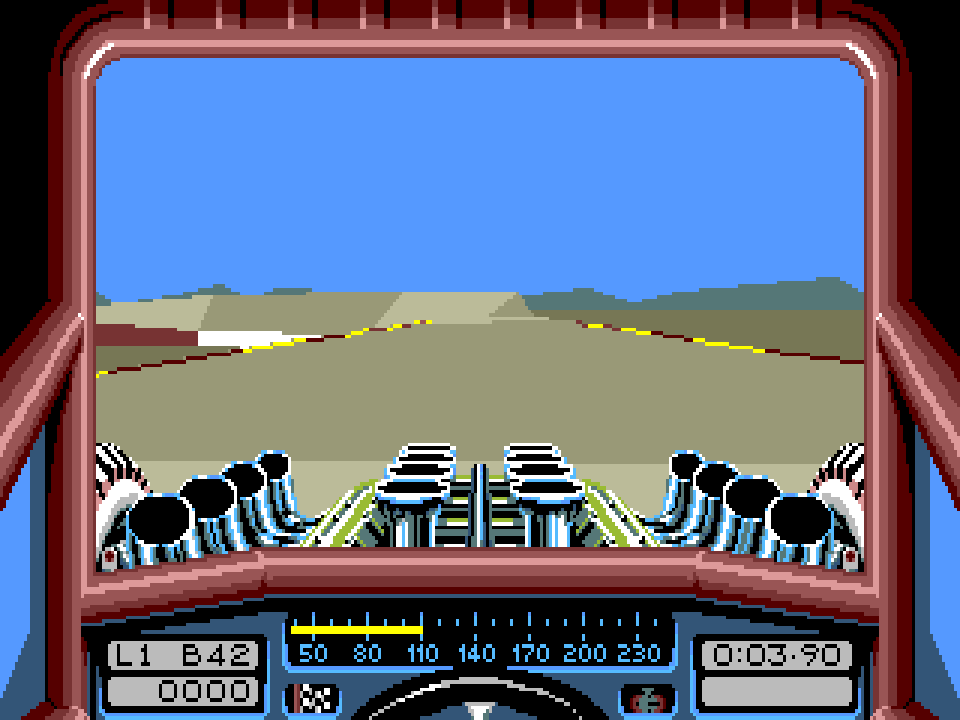
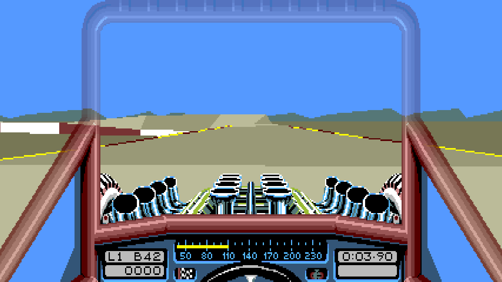
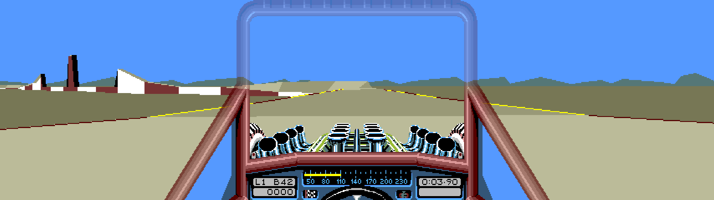

# Stunt Car Racer


  A port of the original <strong>Stunt Car Racer</strong> for Windows. Bring your own Amiga disk image. No emulator required.

[](docs/screenshots/hero.png)

## Features

- **Original racing.** All eight tracks, including Draw Bridge, both leagues,
  Practice and championships, retaining the original physics, AI and race rules.
- **Careers and records.** Multiple single-player careers, autosave, Resume Season
  and a shared Hall of Fame.
- **Personal-best ghosts.** Save best laps from Practice or career races and
  chase them in Practice, with an optional translucent ghost.
- **Local multiplayer.** Championships for 2–8 drivers taking turns, with thirty
  manual save slots.
- **Widescreen and ultrawide.** Original and Extended 4:3, 16:9 and 32:9 views,
  keeping the original car artwork at the same scale.
- **Display options.** Optional 60 FPS smoothing, fullscreen, integer scaling
  and nearest-neighbour or bilinear filtering.
- **Keyboard and controller.** XInput support, Original and Modern driving
  presets, responsive menus and in-game Settings.
- **Original sights and sounds.** Cockpit instruments, animated wheels, engine
  audio and sound effects.

Computer Link is not supported.

### Widescreen

The same frame in Original 4:3, 16:9 and 32:9. The car keeps its original scale.

<p align="center">
  <a href="docs/screenshots/original.png"></a><br>
  <em>Original (4:3)</em>
</p>

<p align="center">
  <a href="docs/screenshots/widescreen.png"></a><br>
  <em>16:9</em>
</p>

<p align="center">
  <a href="docs/screenshots/ultrawide.png"></a><br>
  <em>32:9</em>
</p>

## Play

1. Open **Stunt Car Racer.exe** (source builds: `dist/`).
2. Choose your own [supported Amiga ADF](docs/components/assets.md#import).
   It is imported once; the original file stays unchanged.
3. Choose your settings, press **Play**, then start a career or local championship.

Drive with **arrows/WASD** and **Space** for boost, or an XInput controller.
Original controls latch acceleration; Modern uses held gas. **Esc / controller
Start** opens the Game menu while racing; **F10** opens Settings.

Assets, settings and saves live in `%LOCALAPPDATA%/Stunt Car Racer/`.
See the [player guide](docs/playing.md) for full controls and save recovery.

## Build

Requires **Windows x64**, **Git**, **CMake 4.2+** and **Visual Studio 2026 C++ Build
Tools** with the C++ workload and Windows SDK. Python is optional for extra checks.

```powershell
git clone https://github.com/craigshaw/StuntCarRacer.git
cd StuntCarRacer
cmake --preset windows-release
cmake --build --preset windows-release
ctest --preset windows-release
cmake --install build/windows --config Release
```

Run `dist/Stunt Car Racer.exe`. Game data is imported on first launch; tests
requiring private fixtures are skipped when those inputs are absent.
[Development](docs/development.md) covers Debug builds, fixtures and verification.

## Contribute

Read [architecture](docs/architecture.md), [contributor rules](AGENTS.md) and the
[maintainer references](docs/README.md#maintainer-references). Keep presentation
extensions independent of original gameplay. Run the
[relevant checks](docs/development.md#choose-verification-by-change) before
submitting; keep game assets and generated outputs out of Git.

For bug reports, include the build revision, settings and steps to reproduce.

## Credits and licence

Original game by **Geoff Crammond / MicroStyle (1989)**. Research used
[Vesuri's disassembly](https://github.com/Vesuri/stuntcarracer);
optional original-code tests use [Musashi](https://github.com/kstenerud/Musashi).

Original contributions use the [MIT License](LICENSE). Game and third-party
rights remain with their respective holders; see [third-party notices](THIRD_PARTY_NOTICES.md).
This is an unofficial project, unaffiliated with the original game's rights holders.
Game artwork in the screenshots belongs to its respective rights holders.
